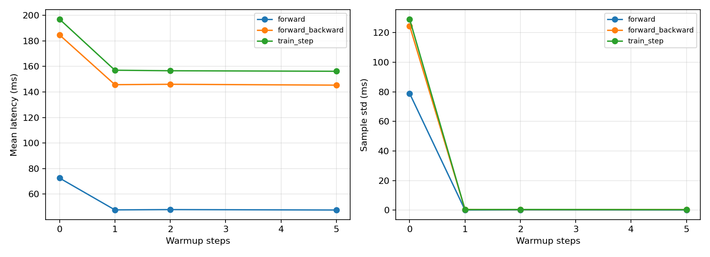
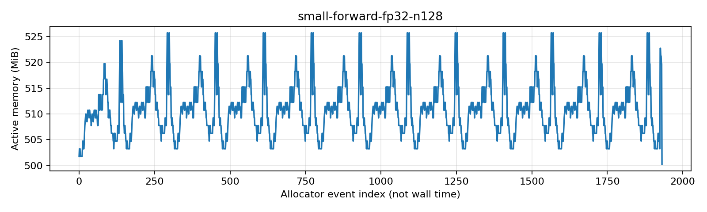
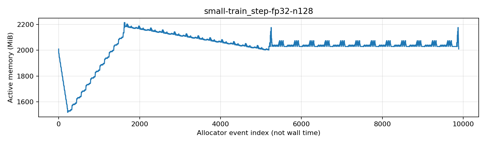
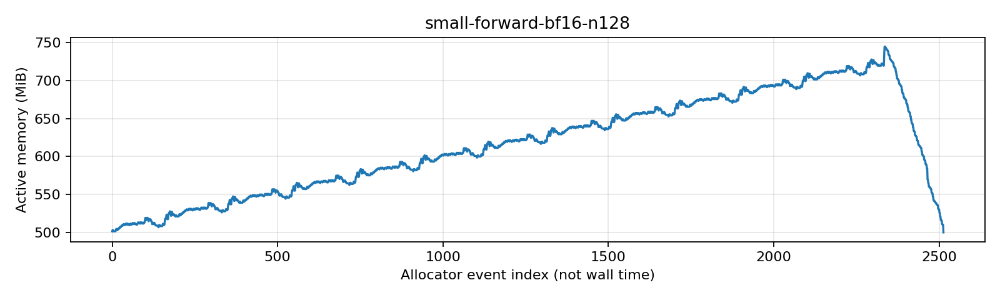
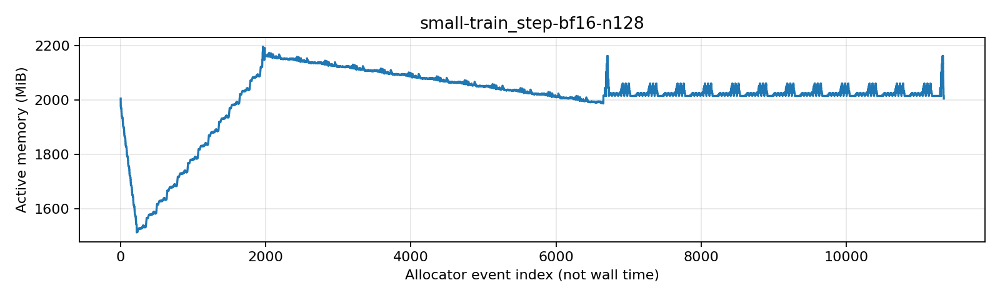
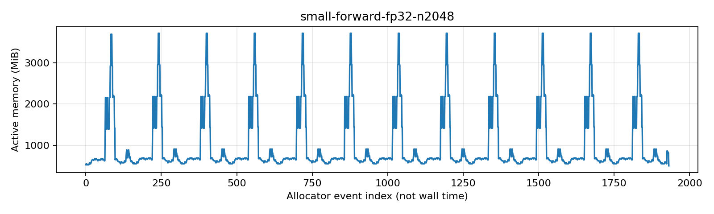
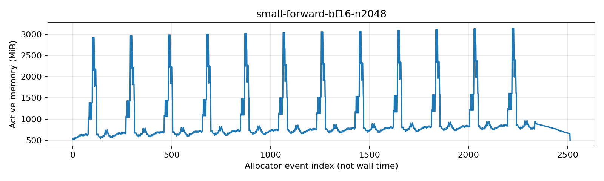

# RTX 3080 Ti：GPU Benchmark、Profiling 与显存实验


这些数据来自实际 RTX 3080 Ti 12GB，不代表 B200。官方模型形状与硬件平台是两件事；表中 small/medium/large 使用讲义模型尺寸、batch=4、vocab=10,000。surrogate 明确属于替代实验。计时使用独立进程、CUDA 同步和 perf_counter，标准差为样本标准差；所有 JSON 保留每轮数据。


## 官方尺寸 FP32 / BF16 对照


单元格为平均值 ± 标准差 / PyTorch peak allocated；warmup=5，测量=10。参数和梯度保持 FP32，BF16 只通过 autocast 使用。计时表使用 torch.optim.Adam，与原 benchmark 一致；Profiler/快照另使用作业参考 AdamW，不混算。


| 模型 | 模式 | FP32 | BF16 autocast | 加速比 |
| --- | --- | --- | --- | --- |
| small | forward | 47.519 ± 0.080 ms / 0.712 GiB | 27.990 ± 0.073 ms / 0.888 GiB | 1.70× |
| small | forward_backward | 145.316 ± 0.350 ms / 4.060 GiB | 84.850 ± 0.076 ms / 3.165 GiB | 1.71× |
| small | train_step | 156.181 ± 0.324 ms / 5.024 GiB | 96.518 ± 0.307 ms / 4.115 GiB | 1.62× |
| medium | forward | 144.975 ± 0.150 ms / 1.884 GiB | 75.533 ± 0.095 ms / 2.542 GiB | 1.92× |
| medium | forward_backward | 432.810 ± 0.349 ms / 10.564 GiB | 237.435 ± 0.193 ms / 8.364 GiB | 1.82× |
| medium | train_step | 实测 OOM (exit 42) | 实测 OOM (exit 42) | N/A |
| large | forward | 294.879 ± 0.228 ms / 4.096 GiB | 146.678 ± 0.086 ms / 5.744 GiB | 2.01× |
| large | forward_backward | 实测 OOM (exit 42) | 实测 OOM (exit 42) | N/A |
| large | train_step | 容量下界超限 (exit 43) | 容量下界超限 (exit 43) | N/A |
| xl | forward | 容量下界超限 (exit 43) | 容量下界超限 (exit 43) | N/A |
| xl | forward_backward | 容量下界超限 (exit 43) | 容量下界超限 (exit 43) | N/A |
| xl | train_step | 容量下界超限 (exit 43) | 容量下界超限 (exit 43) | N/A |
| 10B | forward | 容量下界超限 (exit 43) | 容量下界超限 (exit 43) | N/A |
| 10B | forward_backward | 容量下界超限 (exit 43) | 容量下界超限 (exit 43) | N/A |
| 10B | train_step | 容量下界超限 (exit 43) | 容量下界超限 (exit 43) | N/A |


## Warmup 对照
所有 case 在新进程运行，w=0 包含首次内核/library/optimizer 初始化。不能把不同模式的均值相减当成直接测得的阶段耗时。


| small FP32 | w=0 | w=1 | w=2 | w=5 |
| --- | --- | --- | --- | --- |
| forward | 72.552 ± 78.869 ms / 0.712 GiB | 47.615 ± 0.076 ms / 0.712 GiB | 47.847 ± 0.138 ms / 0.712 GiB | 47.519 ± 0.080 ms / 0.712 GiB |
| forward_backward | 184.661 ± 124.523 ms / 4.060 GiB | 145.688 ± 0.455 ms / 4.060 GiB | 145.994 ± 0.384 ms / 4.060 GiB | 145.316 ± 0.350 ms / 4.060 GiB |
| train_step | 196.979 ± 129.077 ms / 5.024 GiB | 157.005 ± 0.368 ms / 5.024 GiB | 156.590 ± 0.428 ms / 5.024 GiB | 156.181 ± 0.324 ms / 5.024 GiB |




## 显存快照


| 模型 | context | 模式 | 精度 | 结果 |
| --- | --- | --- | --- | --- |
| small | 128 | forward | bf16 | 27.685 ± 0.000 ms / 0.756 GiB |
| small | 2048 | forward | bf16 | 216.085 ± 0.000 ms / 3.097 GiB |
| small | 128 | forward | fp32 | 25.101 ± 0.000 ms / 0.516 GiB |
| small | 2048 | forward | fp32 | 316.302 ± 0.000 ms / 3.634 GiB |
| small | 128 | train_step | bf16 | 108.476 ± 0.000 ms / 2.185 GiB |
| small | 2048 | train_step | bf16 | 实测 OOM (exit 42) |
| small | 128 | train_step | fp32 | 97.327 ± 0.000 ms / 2.190 GiB |
| small | 2048 | train_step | fp32 | 实测 OOM (exit 42) |
| xl | 128 | forward | bf16 | 容量下界超限 (exit 43) |
| xl | 2048 | forward | bf16 | 容量下界超限 (exit 43) |
| xl | 128 | forward | fp32 | 容量下界超限 (exit 43) |
| xl | 2048 | forward | fp32 | 容量下界超限 (exit 43) |
| xl | 128 | train_step | bf16 | 容量下界超限 (exit 43) |
| xl | 2048 | train_step | bf16 | 容量下界超限 (exit 43) |
| xl | 128 | train_step | fp32 | 容量下界超限 (exit 43) |
| xl | 2048 | train_step | fp32 | 容量下界超限 (exit 43) |




















上述 PNG 由真实快照重建，横轴是分配事件编号，不是秒。交互式 `.memory.html` 使用 PyTorch memory_viz；这些是 small 替代图，不是讲义要求的 XL 官方截图。peak allocated、peak reserved 与 nvidia-smi 的进程占用含义不同，不可互换。


## Profiler 阶段计时
开启 Profiler 会扰动运行；以下诊断结果不替代上面的纯计时结果。CUDA event 阶段时长包含该流上的调度间隙，不等于 kernel 时长之和。


| case | Forward | Loss | Backward | Optimizer |
| --- | --- | --- | --- | --- |
| small-forward-bf16-w5-n128-memory.json | 27.266 | 0.000 | 0.000 | 0.000 |
| small-forward-bf16-w5-n2048-memory.json | 215.896 | 0.000 | 0.000 | 0.000 |
| small-forward-fp32-w5-n128-memory.json | 24.763 | 0.000 | 0.000 | 0.000 |
| small-forward-fp32-w5-n2048-memory.json | 316.095 | 0.000 | 0.000 | 0.000 |
| small-forward-fp32-w5-n512-torchprofile.json | 50.844 | 0.000 | 0.000 | 0.000 |
| small-train_step-bf16-w5-n128-memory.json | 30.994 | 0.201 | 49.128 | 27.643 |
| small-train_step-fp32-w5-n128-memory.json | 27.154 | 0.075 | 41.699 | 28.037 |
| small-train_step-fp32-w5-n512-torchprofile.json | 55.618 | 0.225 | 107.193 | 41.160 |
| worker-smoke.json | 7.361 | 0.096 | 12.003 | 1.236 |


## 累加与 ToyModel dtype 实测
```json
{
  "accumulation": [
    {
      "accumulator": "torch.float32",
      "term": "torch.float32",
      "explicit_cast": false,
      "actual": 10.000133514404297,
      "absolute_error": 0.000133514404296875
    },
    {
      "accumulator": "torch.float16",
      "term": "torch.float16",
      "explicit_cast": false,
      "actual": 9.953125,
      "absolute_error": 0.046875
    },
    {
      "accumulator": "torch.float32",
      "term": "torch.float16",
      "explicit_cast": false,
      "actual": 10.00213623046875,
      "absolute_error": 0.00213623046875
    },
    {
      "accumulator": "torch.float32",
      "term": "torch.float16",
      "explicit_cast": true,
      "actual": 10.00213623046875,
      "absolute_error": 0.00213623046875
    }
  ],
  "toy_dtypes": {
    "torch.float16": {
      "parameters_inside_autocast": [
        "torch.float32"
      ],
      "fc1": "torch.float16",
      "relu": "torch.float16",
      "ln": "torch.float32",
      "fc2": "torch.float16",
      "logits": "torch.float16",
      "loss": "torch.float32",
      "gradients": [
        "torch.float32"
      ]
    },
    "torch.bfloat16": {
      "parameters_inside_autocast": [
        "torch.float32"
      ],
      "fc1": "torch.bfloat16",
      "relu": "torch.bfloat16",
      "ln": "torch.float32",
      "fc2": "torch.bfloat16",
      "logits": "torch.bfloat16",
      "loss": "torch.float32",
      "gradients": [
        "torch.float32"
      ]
    }
  },
  "torch": "2.8.0+cu128"
}
```


## 数据与可复现性
原始 JSON：`data/`；命令/stdout/stderr/exit code/GPU telemetry：`../logs/gpu_study/`；Nsight 报告、Chrome trace、显存快照：`artifacts/`。退出码 42 是实测 OOM；43 是容量下界阻断；不能把它们当作成功 benchmark。所有当前无法完成的官方结果须在最终 writeup 标为缺失。
