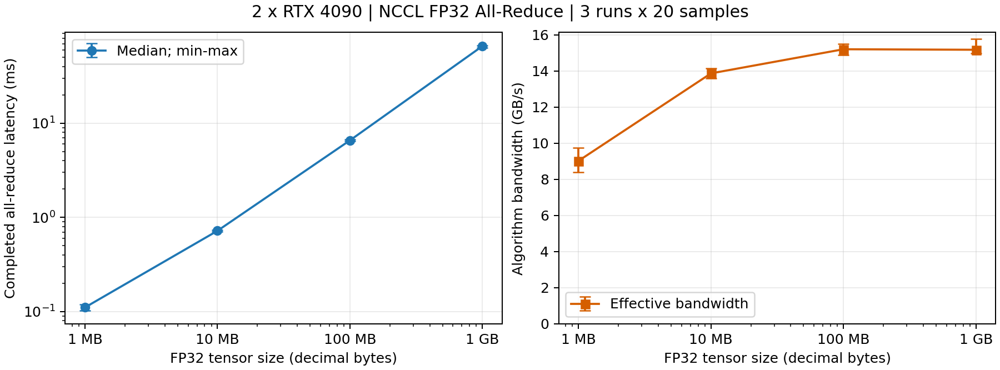

# 双 RTX 4090 NCCL All-Reduce Benchmark

仅运行 NCCL All-Reduce；DDP、Optimizer Sharding、FSDP、单卡实验、4/6 GPU 和 B200 均未运行。

## 讲义与配置

handout 第 32 页 distributed_communication_single_node 要求 FP32 的 1MB、10MB、100MB、1GB，比较 2/4/6 GPU，每次运行少于 5 分钟；建议 5 次 warmup、CUDA synchronize、汇总各 Rank。讲义没有固定测量次数或统计量。本轮只完成实际可用的 2 GPU 档，采用十进制 MB/GB（1MB=1,000,000 bytes），每档 5 次 warmup + 20 次测量，独立重启 torchrun 重复 3 轮，共 60 个正式样本；正式测试前四档消息均通过 1 warmup + 2 次测量的冒烟。

环境：Python=/root/miniconda3/bin/python，PyTorch=2.8.0+cu128，CUDA=12.8，NCCL=[2, 27, 3]；CUDA_VISIBLE_DEVICES=0,1，OMP_NUM_THREADS=1。没有安装或升级远端依赖。实际命令、环境、UTC 时间、退出码和 stdout/stderr 均见 *.command.json 与对应日志。三轮正式进程总时长分别为 6.78s, 6.57s, 6.78s，均小于 5 分钟。

## 计时和带宽口径

每次通信前重新填充 Rank 0=1、Rank 1=2；barrier 后同步 CUDA，再记录 perf_counter_ns；dist.all_reduce(SUM) 返回后再次 CUDA synchronize，最后记录结束时间。每步耗时取 max(两个 Rank 的结束时间)-min(两个 Rank 的开始时间)，使用同节点共享 monotonic clock；包括通信完成等待和 API/同步开销，排除 barrier、填充和结果验证。原始双 Rank 起止时间全部保存，并由分析脚本逐项重算验证。

有效带宽 algorithm GB/s = 消息字节数 / (延迟中位数 ms × 10^6)。NCCL 常用归一化 bus GB/s = algorithm GB/s × 2(N-1)/N；N=2 时二者相同。这是由 collective 耗时计算的有效吞吐，不是物理链路计数器读数。波动范围为 60 个双 Rank 完成时间的 min–max；JSON 另提供 mean、样本标准差、P5/P95 和三次独立中位数。

## 实测结果

| 消息 | 延迟中位数 ms | min–max ms | 标准差 ms | 有效带宽 GB/s | 样本数 |
|---|---:|---:|---:|---:|---:|
| 1MB | 0.1108 | 0.1025–0.1193 | 0.0038 | 9.022 | 60 |
| 10MB | 0.7214 | 0.7068–0.7358 | 0.0059 | 13.861 | 60 |
| 100MB | 6.5804 | 6.4593–6.7192 | 0.0665 | 15.197 | 60 |
| 1GB | 65.9282 | 63.4342–66.7434 | 0.9208 | 15.168 | 60 |

## 性能趋势与限制

从 1MB 到 1GB，延迟由 0.1108ms 增至 65.9282ms，有效带宽由 9.022 增至 15.168 GB/s。小消息更容易受 collective 启动、进程调度和 CUDA 同步的固定开销影响；大消息主要反映实际可用通信路径的吞吐。

本机 GPU 间 topology 为 NODE，跨同 NUMA 节点的 PCIe host bridges，无 NVLink。该拓扑及大消息有效带宽与通信路径限制相容；仅凭此测试不能区分 PCIe、host staging、CPU 内存或 NCCL 算法各自贡献，未把有效吞吐当作某条物理链路的带宽。4/6 GPU 的扩展曲线未测，双 4090 数据不替代其他卡数或 B200。

## 正确性与退出

每种消息在每轮最后一次 All-Reduce 后，两个 Rank 都检查整个 FP32 张量是否逐元素等于 3；检查 250,000 / 2,500,000 / 25,000,000 / 250,000,000 个元素，错误元素数全部为 0。冒烟及三轮正式运行所有 worker 均通过 destroy_process_group 正常退出，torchrun 退出码均为 0。实验结束不执行任何实例关机、释放或重启操作；最终 GPU 空闲状态见 idle-after.txt。

## 原始文件与同步

*.json 保留配置、原始时间、逐 Rank 正确性与版本；*.command.json / *.stdout.log / *.stderr.log / *.exit_code.txt 保存实际执行记录，sources/ 为运行源码快照。远端原始文件的 SHA256SUMS 在 WSL 下载后逐文件核验，结果见 SYNC_VERIFICATION.json；本地生成的报告与图表单独列入 LOCAL_SHA256SUMS。
